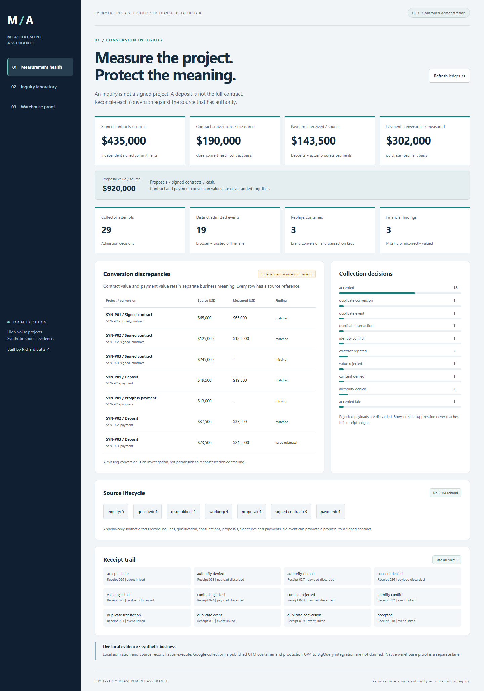
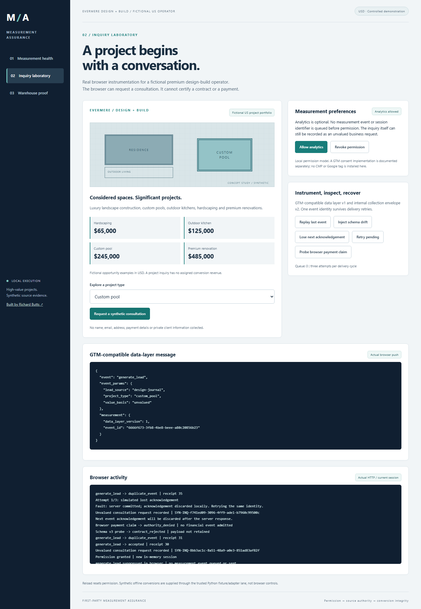
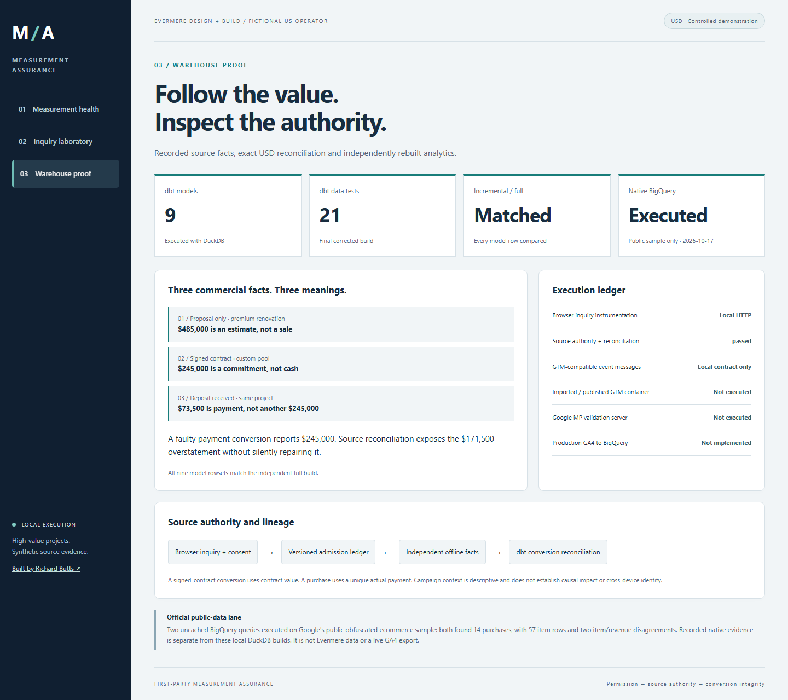

# First-Party Measurement Assurance

**A $245,000 project is signed. The customer pays a $73,500 deposit. Why does marketing report another $245,000 purchase?**

This executable measurement platform explains conversion errors for **Evermere Design + Build**, a fictional premium US home-services operator. It connects real browser inquiries to consent-aware collection, authoritative offline project facts, durable receipts and dbt reconciliation. Luxury landscapes, custom pools, outdoor kitchens, hardscaping and premium renovations provide high-value measurement cases.

**All companies, projects, contracts and payments are synthetic. USD is the primary scenario's only currency.** Browser HTTP, local processing and DuckDB/dbt execute. GTM compatibility, Google debug validation and native BigQuery are distinct evidence boundaries. No private credential is required to run the core.



The exact fixture has **$920,000 in proposals, $435,000 in signed contracts and $143,500 in actual payments**. Measured contract conversions total $190,000; measured payment conversions total $302,000. The system exposes three financial findings: a missing $245,000 contract conversion, a missing $13,000 progress-payment conversion and a deposit overstated by $171,500.

**Proposal value is not signed contract value. Signed contract value is not collected cash. A deposit is not another full contract.** Those values remain separate in the interface, SQL grains and evidence. These are hand-authored synthetic cases, not client revenue or measured commercial uplift. [Exact results](docs/evidence/demo.json) and [evidence index](docs/evidence/README.md).

## Try the application

Use **Python 3.12** from the existing source checkout:

```text
python -m venv .venv
```

Activate `.venv\Scripts\Activate.ps1` on Windows, or `source .venv/bin/activate` on macOS/Linux, then:

```text
python -m pip install -r requirements.lock
python -m playwright install chromium
python -m assurance.server --fixture --workspace .local/projects-v2
```

Open `http://127.0.0.1:8550`. On Linux, browser tests may require `python -m playwright install --with-deps chromium`. This server binds to loopback. Use a fresh v2 workspace: earlier databases are refused and left untouched.

1. **Measurement health:** compare source contracts and payments with their separate measured conversions. Inspect stage counts, rejected attempts, late arrivals and receipt details.
2. **Inquiry laboratory:** request a consultation before permission, allow analytics, inspect the real GTM-compatible data-layer message, replay it, introduce schema drift and lose an acknowledgement.
3. **Warehouse proof:** inspect recorded local dbt results, the exact contract-versus-deposit failure and explicit native-access limits.



The concept drawing is CSS; screenshots are genuine captures of the running application. Project opportunities include $65,000, $125,000, $245,000 and $485,000. An inquiry collects no contact details and receives no assumed conversion revenue. It cannot qualify a lead, sign a contract or receive payment. [Browser execution and screenshot provenance](docs/evidence/browser.json).

## Commercial definitions and authority

| Business fact | Measurement | Authority and value |
|---|---|---|
| Website inquiry / consultation request | `generate_lead` | Browser after an independent inquiry receipt; unvalued |
| Qualified lead | `qualify_lead` | Trusted offline source; unvalued |
| Consultation/contact underway | `working_lead` | Trusted offline source; unvalued |
| Disqualified lead | `disqualify_lead` | Trusted offline source; unvalued |
| Estimate or proposal | Source context only | No sale, payment or assumed conversion revenue |
| Signed contract | `close_convert_lead` | Trusted signature source; signed USD commitment once |
| Actual deposit or progress payment | `purchase` | Trusted payment source; unique transaction and actual USD amount |

The browser-facing collector cannot grant itself offline authority, even if a request claims `origin=offline`. Offline events must match the registered source stage, project, timestamp and eligible session association. The source fixture/adapter lane is Python-only; there is no browser payment, signature or arbitrary source-write endpoint. This is a bounded source-authority demonstration, not a rebuilt CRM or general ledger.

## Controls under failure

| Problem | Executed behavior |
|---|---|
| No analytics permission | Inquiry can succeed; measurement is suppressed before queuing |
| Permission revoked during retry | Pending events are cleared; current server permission gates admission |
| A delayed grant response arrives | Generation fencing prevents it from overriding revocation |
| Response lost after commit | Retry the same ID; record another receipt and one admitted effect |
| New ID for an existing conversion/payment | Independent conversion and transaction keys prevent repeated value |
| Same identity, different content | Named conflict; original admitted content remains immutable |
| Unknown fields or schema drift | Closed internal v2 contract rejects without retaining payload bytes |
| Payment items do not sum to value | Integer-cent admission check and dbt conservation gate |
| Payment uses full contract value | Self-consistent event remains visibly mismatched with authoritative payment |
| Late conversion | Explicit seven-day arrival policy, late flag and original event date |
| Nested payment items cause fanout | Separate event/item/payment grains and source-total checks |

## Engineering evidence

```text
python scripts/verify.py
```

The verifier runs Python/API and native-adapter contract tests, actual Chromium interactions, three successful dbt builds, a deliberately failing SQL experiment, exact incremental/full equivalence, independent Python reconciliation, deterministic fixture checks, screenshot/source integrity, Markdown targets and a public-file audit. Runtime data and logs stay in ignored workspaces.

The revised demonstration has **29 admission attempts, 19 distinct events, three contained replays, one late arrival and three unresolved financial findings**. All **nine dbt models** compare exactly with an independent full build. Each successful build passes **21 data tests**. [Executed verification](docs/evidence/verification.json) and [control-to-test map](docs/testing.md).



## GTM and Google boundaries

| Evidence lane | Actual status |
|---|---|
| Real browser instrumentation | Local HTTP and actual `dataLayer.push` with the standard `event` property |
| GTM-compatible data layer | Version 1 contract tested independently of internal collection envelope v2 |
| Imported/published GTM container | **Not configured or executed**; concrete [implementation guide](docs/gtm-implementation.md) provided |
| Local source-to-analytics processing | SQLite, DuckDB/dbt, independent source oracle and full-build comparison executed |
| GA4 payload projection | Six documented lead/payment event patterns, USD units and explicit value basis locally tested |
| Google Measurement Protocol debug | **Not executed**; requires an approved isolated property configuration |
| Native BigQuery public sample | **Not executed**; requires authorized project/ADC access |
| Production GA4 to BigQuery integration | **Not implemented or claimed** |
| Hosted GitHub CI | [Windows and Ubuntu verification](https://github.com/rlbsem/first-party-measurement-assurance/actions/workflows/verify.yml); inspect the run for the relevant commit |

The official public GA4 ecommerce sample remains a separate optional GoogleSQL validation lane. It is not Evermere data. No Google tag, paid resource, native connector success or deployment is implied by local results. [Native runbook](docs/native-google.md) and [official references](docs/sources.md).

[Architecture and source lineage](docs/architecture.md) / [Operations and limits](docs/operations.md) / [Scenario revision and retained controls](docs/scenario-revision.md).

This project focuses on browser measurement, source authority and conversion integrity. It complements [Customer Signal & Activation](https://github.com/rlbsem/customer-signal-activation) and [Revenue Metrics Platform](https://github.com/rlbsem/revenue-metrics-platform) without recreating their activation or financial systems.

Built by [Richard Butts](https://github.com/rlbsem).
