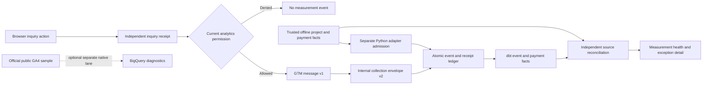

# Architecture and source lineage

Evermere Design + Build is a fictional US operator. Projects are deliberately small in count and large in value; this is a measurement-assurance demonstration, not a throughput benchmark or a CRM/finance replacement.

## Two authority lanes

The browser may submit an unvalued synthetic inquiry. The business API generates its source receipt and timestamp separately. Only a successful receipt and current analytics permission allow a `generate_lead` event. Browser-origin events can never qualify/disqualify a lead, report a consultation as underway, sign a contract or receive money. The `origin` field is checked against the server-selected ingress lane, not trusted as authorization.

A Python-only fixture/adapter boundary registers immutable source facts and admits offline `qualify_lead`, `working_lead`, `disqualify_lead`, `close_convert_lead` and `purchase` events. It has no public HTTP writer. Every conversion must match the source reference, stage, project, original timestamp and eligible session association. A proposal reference cannot authorize a signed-contract conversion. This is process/code separation within a loopback application, not production service authentication or IAM.

Source projects carry indicative opportunity amounts. Separate source facts record proposals, signatures and actual payments. The bounded source importer permits one immutable proposal and one immutable signed contract per project, and prevents payments without a contract or payments exceeding its remaining value. It does not implement collections, amendments, refunds, tax, accounts receivable or full CRM lifecycle enforcement. The fixtures supply coherent September inquiries, October proposals, January signatures and payments.

## Value definitions

- Inquiry, qualified, disqualified and working lead events are **unvalued**. Internal zero cents is a nonfinancial sentinel; GA4 projections omit `value` and `currency` entirely for these stages.
- Proposal value is source context. No financial conversion is generated from an estimate.
- `close_convert_lead` carries the signed commitment with `value_basis=contract`.
- `purchase` carries one actual payment, a unique payment transaction ID and `value_basis=payment`. Payment items describe that transaction amount, not the whole project again.

For the pool project, the source contract is $245,000 and its deposit is $73,500. A deliberately faulty conversion uses $245,000 for the deposit. Its items sum correctly, so structural validation alone cannot catch the mistake. Source reconciliation identifies a $171,500 payment overstatement. It preserves the original event and flags the discrepancy instead of silently replacing its content.

Contract and payment sums remain separate in every daily/campaign grain and in the UI. There is no additive total of contracts plus deposits and no computed revenue recognition.

## Versioned browser and collection contracts

[Data-layer v1](../contracts/data-layer-v1.json) is a standard GTM-compatible object with `event`, nested `event_params` and non-sensitive version/event identity metadata. The browser does not put session authority, source references, contact details or quote values into this message. Its standard `generate_lead` name and `lead_source` parameter follow Google documentation; project type and value basis are explicitly custom parameters.

[Internal envelope v2](../contracts/event-v2.json) is independently versioned and closed at all levels. It carries private local collection authority, source lineage, integer USD cents and explicit value basis. The GTM message and private request derive from one browser event identity; collector retries do not push a second GTM message. Unknown versions, fields or incompatible types are rejected with a fixed reason, and rejected payloads are not retained. The original internal v1 contract and databases are not silently reinterpreted; see [revision boundary](scenario-revision.md).

`ga4_params` projects local integer cents to ordinary USD decimal units and omits internal envelope fields. It never sends events. These local checks establish compatibility for the supported subset, not native Google validation or Google-side deduplication. The seven-day local admission rule does not assert that Google accepts the same backdating window; debug examples omit historical backdating.

## Atomic receipts and replay

SQLite `BEGIN IMMEDIATE` encloses current permission, source authority, identity checks, event insertion and receipt insertion. A unique event key prevents exact retries from creating another event. A separate event-name/source-reference conversion key prevents repeated lead/contract value under a new ID; payment transaction identity also remains unique.

Exact retries return `duplicate_event`. Changed content under the same ID returns `identity_conflict`. New IDs under an existing conversion return `duplicate_conversion` or `conversion_conflict`; payments retain `duplicate_transaction`/`transaction_conflict`. Canonical economics include project, currency, value basis, value and items. A descriptive campaign change under a new ID does not create another economic effect. Reordered payment items are conservatively different content.

Events are immutable. Receipt links point to the admitted original; conflicting payloads are discarded. A pre-commit failure rolls event and receipt back together; restart/retry and 16 concurrent calls are tested. A lost acknowledgement after a real local HTTP commit produces another receipt with one admitted effect. This is bounded retry with idempotent effects, not exactly-once transport.

## Consent and privacy

Analytics defaults to denied on reload. There is no persistent tracking ID, cookie, raw URL, email, referrer or contact field. Only enumerated synthetic campaign and service values cross the measurement boundary. The business inquiry can exist without analytics permission and is then `not_eligible`, rather than an inferred missing conversion.

A grant creates a random in-memory local session authority. Revocation clears pending events and messages while preserving the data-layer array identity; a generation counter fences delayed grant responses. The server also checks current permission. Historical admitted events remain after revocation; this is not erasure. A failed server revocation request leaves the browser closed but requires retry to invalidate the remote authority.

Source facts record eligibility at source capture. Current permission is required again at collection. The fixture supplies historical source/session associations; the demo does not independently certify historical consent, a legal basis or a real person's identity. Changing the session on an old source does not reauthorize it. No denied inquiry is retroactively linked after later permission.

The operator receipt view redacts session authority. Its hash binds original admitted content, not the redacted projection. Source integrity is verified before export. A snapshot read transaction makes the source export consistent. Hashes do not protect against a malicious local filesystem administrator. Only fixed synthetic fixture sessions appear in public source evidence.

## Nine analytical models

| Model | Grain and purpose |
|---|---|
| `fct_events` | One admitted event; incremental delete/insert by event ID |
| `fct_items` | Payment event/item index; exact cent conservation |
| `fct_purchases` | One actual measured payment transaction |
| `fct_conversions` | Event name/source reference; distinct lifecycle and value basis |
| `mart_reconciliation` | Full union of source and measured conversion keys |
| `mart_daily` | Event day/currency/value basis/event name |
| `mart_channels` | Campaign/currency/value basis/event name |
| `mart_health` | Collection decision status |
| `mart_project_values` | Project; proposals, signatures, source payments and separate measured values |

Source facts and measured events aggregate separately before the project join. Expected conversion mapping excludes proposals and retains nonfinancial lead stages without manufacturing dollar values. Reconciliation distinguishes matched, missing, value-mismatched, unexpected and not-eligible rows. Source relationships and authority gates stop unauthorized orphans before publication; the full outer comparison also diagnoses unexpected rows if a downstream input is corrupted.

The incremental event model intentionally re-reads this bounded immutable ledger rather than using `max(event_time)`. A January 15 deposit arriving January 17 remains on January 15. All nine model rowsets compare exactly with a separate full warehouse build; an independent Python source traversal checks conversion reconciliation. No scale or limited-scan performance claim is made.

The live health UI reads a consistent SQLite snapshot and Python oracle; the warehouse view presents explicitly recorded dbt results. They are different consumer paths, clearly labelled. Campaign grouping is descriptive source context, not causal incrementality, multi-touch attribution or cross-device identity. Collector counts cannot estimate traffic suppressed before collection.
