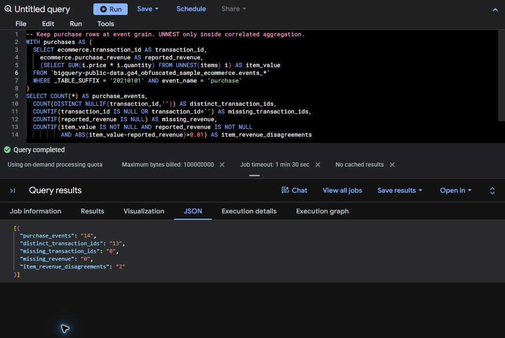

# Native BigQuery public-sample execution

**Executed 2026-10-17 in BigQuery Studio using an authorized billing-disabled sandbox.** This is Google's obfuscated GA4 ecommerce sample, not Evermere's synthetic projects. It proves real GoogleSQL execution; it does not prove Python ADC authentication, dbt-bigquery models, Measurement Protocol validation, live GA4 ingestion or export.

Two public-data queries completed uncached against the `20210101` shard. A third, metadata-only query read just those two job records. Each tab used a 100,000,000-byte maximum, a 90-second job timeout and temporary results. No billing account, payment method or persistent dataset was configured.

| Query | Job ID | Processed bytes | Job-reported billed bytes | Slot ms |
|---|---|---:|---:|---:|
| Event health | `job_JKIqXynG1hJxZJ06oOVpnxXeV1Dm` | 8,564,154 | 10,485,760 | 112 |
| Purchase grain | `job_EgSHl_of2fLqQeIIjpuktW4Bk8AM` | 470,013 | 10,485,760 | 73 |
| Metadata lookup | `job_JzOfDrz0KroLm9z5RuBbGf3NPFjS` | 0 | 0 | 448 |

The public-data jobs processed **9,034,167 bytes** combined. BigQuery reports a minimum 10 MiB of billed bytes for each data query; that counter is not an invoice or a charge. The project remained billing-disabled. Both jobs report `DONE`, no error, `SELECT` and `cache_hit=false`. Exact UTC timestamps appear in the evidence.

## What the source actually showed

- Both independent queries found **14 purchase events**.
- Those events contain **57 item rows**. Flattening items and counting rows would inflate the event count; the queries retain event grain and aggregate items through correlated subqueries.
- There are **13 distinct transaction IDs**, with zero null/empty IDs. A repeated identifier is observable, but this alone does not prove an ingestion duplicate.
- **Two purchases have item-value/reported-revenue disagreements** under the recorded one-cent comparison. They remain findings. The queries do not diagnose a specific cause or assume equality after accounting for tax, shipping or obfuscation.
- All 16 event-name groups report zero missing pseudo IDs, missing session keys and duplicate session-key entries on this shard. This is a bounded observation, not a guarantee about the full dataset or other dates.

Google documents placeholder values and limited internal consistency in this [obfuscated sample](https://developers.google.com/analytics/bigquery/web-ecommerce-demo-dataset). Consequently, the count comparison passes while source-quality findings remain visible. The local USD contract/payment reconciliation is unchanged and separate.



This screenshot is a direct crop of the running Google Cloud Console. It excludes the account, project selector, resource sidebar and address. No result pixels were edited. Crop dimensions and SHA-256 are recorded in the acceptance JSON. The original application screenshots were recaptured after their native-status text changed; they still show the local synthetic demonstration.

## Inspect and reproduce

- [Acceptance record](acceptance.json): normalized aggregate rows, SQL/source hashes, query settings, exact job statistics, scope and screenshot provenance.
- [Provider job metadata results](job-statistics-results.json): the unmodified field values shown by Google's JSON result view, with project/user fields excluded by the query itself.
- [Metadata SQL actually executed](job-statistics.sql): restricted to the two job IDs and execution date, without selecting project or user identity.
- [Event-health SQL](../../../bigquery/event_health.sql) and [purchase-grain SQL](../../../bigquery/purchase_grain.sql).
- [Console and optional Python reproduction instructions](../../native-google.md).

The console validator supplied real pre-execution estimates displayed as **8.17 MB** and **459 KB**. These are rounded displays; no exact estimate bytes or Python `dry_run=True` call are claimed. Both estimates were inspected before either data query ran. The metadata estimate was 0 B.

Google's job metadata independently reports SHA-256 for the executed queries. The editor used CRLF line endings; the checked source files use LF. The evidence records both hashes, and the offline checker requires the executed hash to equal the CRLF form of the exact tracked SQL. No other query rewriting occurred.

```text
python scripts/check_google_evidence.py
python scripts/verify.py --check-archive
```

These commands validate the stored evidence and rerun the credential-free core. They do **not** submit new Google jobs. The full verifier checks recorded SQL hashes, provider metadata, independent count parity, unrepaired findings and screenshot integrity. Focused negative tests reject altered hashes, unfinished jobs, cache hits, budget violations, count disagreement and hidden source findings.

The native client was **Google Cloud Console / BigQuery Studio**, whose version is not exposed. No Python Google client version is claimed. Private project IDs, user identity, raw browser logs and credentials are excluded. Job IDs are non-secret provenance; access to Google's job history still requires the owner's authorized project. Public evidence is a sanitized execution record, not a vendor-signed attestation. Another reader can reproduce the public queries in their own sandbox.

**Measurement Protocol debug remains blocked:** the owner confirmed no isolated test property is configured. No debug or production collection request was sent. GTM publication, production GA4 integration, dbt-bigquery execution and production deployment remain unexecuted.

The prior [77-test baseline evidence](https://github.com/rlbsem/first-party-measurement-assurance/blob/69f0053ee7800f11e7856bc82130dd1c79597dc3/docs/evidence/verification.json) remains in Git history. Collection, consent, source authority, financial fixtures, SQL models and the original test files are unchanged. Current application captures were refreshed only to replace the formerly pending native-status text.
