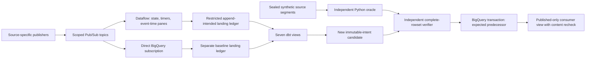

# Governed streaming measurement and recovery

The streaming lane asks whether independently authorized web, contract and payment sources can produce correct measures despite replay, corrections, ambiguous acknowledgments and failed processing. Signed commitments and cash remain separate USD measures. All inputs are synthetic.

**Execution boundary:** source contracts, a real Beam DirectRunner pipeline, SQLite publication transactions and the independent source oracle execute locally. The native campaign and Terraform are implemented; Pub/Sub, Dataflow, native streaming publication, native recovery and comparative performance have **not executed**. The [earlier native BigQuery/dbt acceptance](evidence/native-dbt-bigquery/README.md) is separate historical evidence. It does not validate this streaming lane. A separate [non-billable BigQuery dry run](evidence/streaming/sql-planning-2026-11-15/README.md) type-checked the seven models and published-view SQL; it did not execute them or the approval transaction.

## Architecture and decisions



- **Authority follows the authenticated topic reader.** Payload tenant/source strings grant no rights. Separate source accounts receive only their topic's publish permission. Raw observations remain restricted; rejected payloads never enter provisional counts or approved facts. Operational rejection logs retain hashes and reasons.
- **Delivery and business identity differ.** Both sinks can append duplicates. Canonical identity includes operator, legal entity, authorized source, event type and business ID; revision selects the current value. Equal-revision content conflicts block the affected operator. An old revision cannot regress a later value.
- **State is operational, not the financial source of truth.** Beam uses keyed state, event-time and idle timers, one-minute accumulating panes and a ten-minute live horizon. Beyond-horizon observations remain in the ledger and generate named rebuild requests in the observations table. A watermark does not establish source completeness.
- **Completeness checks positions and bytes.** Every sealed source segment, position and payload must match. Equal row counts or equal financial totals alone cannot satisfy the gate. Separate source-only Python code reconstructs every canonical fact and validates integer-cent conservation.
- **Publication is transactional within BigQuery.** A candidate/proof pair, current source admission, policy and expected predecessor must match in one transaction. Exact request retries reconcile the old receipt; they do not authorize a new action. Other services are outside that transaction.
- **BigQuery IAM does not offer append-only `updateData`.** Builder privileges can technically mutate candidate rows. Approval checks the content root, and the published authorized view rechecks it against the verifier's separate certificate on every read. Altered selected content fails closed. This is integrity checking and privilege separation, not WORM storage or protection from a project administrator. The approver is a trusted server-side principal: its table permissions are not restricted to one SQL statement. The suite tests the governed transaction and denied lower-privilege callers, not a compromised approver credential.
- **Recovery retains the advanced sink.** The runner attempts a native snapshot, records any provider rejection, and distinguishes snapshot restore from cold archive reconstruction. It requires newly issued replay message IDs in both sinks, rebuilds a fresh candidate and compares the complete result. Re-reading an old candidate alone is insufficient.
- **The baseline may be preferable.** For batch-governed final measures, direct Pub/Sub-to-BigQuery ingestion avoids worker/state complexity. Dataflow adds bounded operational deduplication, revision observations, timers, provisional event-time panes and rebuild signaling. Neither architecture receives a performance or cost advantage before measurement.

The seven native views preserve event/revision, payment-item, session, project, day/measure and exception grains. Consumer comparisons must filter both lane and cohort: architecture paths and repeated load experiments are separate result sets, not additive revenue. Marketing eligibility is a source assertion under a versioned policy; it does not create a cross-system instantaneous consent registry. Original browser consent protections are unchanged.

## Reproduce without cloud credentials

Use Python 3.12 and a separate environment from the original browser/dbt application:

```text
python -m venv .stream-venv
python -m pip install -r requirements-streaming.lock
python -m pytest streaming_tests -q --basetemp=.local/streaming-tests
python -m streaming.local_demo --work .local/streaming-demo
python scripts/check_warehouse_preservation.py
python scripts/package_streaming.py --check
```

Activate that environment before the commands after installation. The demo requires a fresh output directory and makes no cloud calls. The [recorded local acceptance](evidence/streaming/local-2026-11-15/README.md) includes source bytes, independent financial results and explicit local boundaries.

Terraform 1.13.5 supports the provider-mocked tests without credentials:

```text
terraform -chdir=infra/streaming init -backend=false
terraform -chdir=infra/streaming validate
terraform -chdir=infra/streaming test
terraform -chdir=infra/streaming-bootstrap init -backend=false
terraform -chdir=infra/streaming-bootstrap validate
```

The additive [streaming package inventory](https://github.com/rlbsem/first-party-measurement-assurance/blob/feat/gcp-streaming-control-plane/streaming-package-manifest.json) covers the full source, provider locks, worker image definition and native dbt project. The original core package helper and protected historical files are preserved.

## Native campaign and operating envelope

See [the engineering contract](gcp-streaming-control-plane-acceptance.md). Native commands have no default deployment. `python -m streaming.native --help` exposes separate read-only preflight, review preparation, approved execution, inventory and evidence export operations.

The private owner review binds the exact source hashes, Terraform executable/plans, regional rates and quota observations. A finite image build resolves the worker digest; the final plan may differ only by that reviewed digest substitution. Other permission or resource drift blocks apply. Enabling required APIs, applying infrastructure or launching workloads requires explicit owner approval.

The [second native image attempt](evidence/streaming/native-image-2026-11-15/README.md) failed in Docker step 0 before runtime deployment; the provider API and console exposed no text log. Current build configuration instead directs logs to the existing owned private build bucket. A conditional bucket grant permits writes only to `log-` objects, replacing project-wide Logs Writer. Admission requires a nonempty, generation-pinned, hash-verified log export as well as independent image digest readback. Cleanup archives all source and log generations before deletion. This revised logging path is tested offline and has not executed natively.

The [subsequent admission request](evidence/streaming/native-admission-2026-11-15/README.md) was rejected with HTTP 400 before any build job existed. Current bootstrap adds bucket-scoped metadata read access and grants the operator short-lived impersonation of only the owned build identity. Before source upload or build submission, that identity must read the owned bucket, write and read back a synthetic `log-` object, reject a source-object write and remove the verified probe generations. Independent owner readback and private receipts preserve the observation. Only metadata authorization reads can retry during a bounded IAM propagation wait; uncertain effectful writes are not resubmitted by this probe. No project-wide Storage Admin grant or persistent key is used. These effective checks have not yet run natively.

The staged runner implements: canary; complete source reconciliation; spoof/conflict/clock probes; separate-principal IAM denials; unpublished-content checks; competing approvals and rollback; current-policy revocation; sink-ahead snapshot/archive recovery; and same-input 100K/1M comparisons on one and two workers. Large cohorts are mostly browser observations with sparse financial samples, rather than fabricated mass sales. Skewed cohorts replay hot keys; physical attempts and unique business effects have separate denominators.

Test targets are **zero unexplained source loss, zero repeated financial value, exact baseline/Dataflow canonical parity, one valid successor per predecessor, 600-second bounded ingestion/replay waits and a three-hour campaign deadline**. Publication latency percentiles are measured from availability of the complete sealed archive to the observed cohort approval receipt, including publisher queuing. A batch release can legitimately give identical percentiles for all its events. Sink visibility is an upper bound from five-second polls, not a fabricated provider commit time. Provider backlog/watermark/utilization fields are retained with their actual names and missing observations remain missing. A finite one-million-event run would not establish unrestricted capacity or commercial uplift.

## Cleanup and residual boundaries

The [November 15 UTC bootstrap record](evidence/streaming/native-bootstrap-2026-11-15/README.md) preserves an actual aborted image-build attempt, the controller correction and independent cleanup observations. Runtime deployment and streaming acceptance did not begin. A cancelled build, an available quota and a successful metadata read are separate observations from completed native processing.

A one-shot Cloud Tasks deadline invokes an independently scoped Cloud Run stopper. Arming checks the scheduled request, identity, image and exact arguments before starting Dataflow. The stopper has three bounded attempts; it is not a recurring experiment and does not retire every resource.

The owner-side retirement path separately stops jobs, deletes owned snapshots, verifies every exported GCS generation, refuses late unarchived writes, retires Terraform resources and reads fresh provider inventory. It preserves errors and private state if cleanup fails. No secret values are fetched.

Offline whole-inventory tests check both Dataflow and Pub/Sub snapshot residuals, including randomly named source snapshots identified by an exact registry entry after topic deletion. Partial-run retirement tolerates genuinely absent generated model datasets, while authorization errors and foreign ownership still stop deletion. These are software tests of provider contracts; they are not native teardown results.

Logical absence does not establish physical erasure or billing clearance: seven-day GCS soft deletion, BigQuery time travel/fail-safe retention, provider logs/history, enabled APIs, managed service identities and deletion tombstones can remain. Pricing reservations and provider charge records are separate. No native success, throughput, recovery duration or actual streaming charge is claimed before execution.
